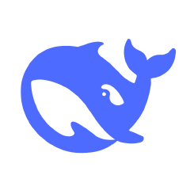

# 碧蓝航线 · 静态立绘还原工具


把游戏资源里被切碎、散落在图集里的立绘，还原成**一张完整的透明底 PNG**（含表情差分）。

**Azur Lane Painting Restore** — reassemble the fragmented paintings in the game asset
bundles into one full transparent PNG, with every expression variant.

> [!WARNING]
> 仅供个人学习、研究使用。游戏素材版权归 蛮啾网络 / 勇仕网络 所有；请勿用于 MOD 制作、二次分发或商业用途。
> For personal study and research only. Assets © Manjuu / Yongshi.
> Do not use this tool or its output for MODs, redistribution or commercial use.


## 快速开始 · Quick start

需要 Python 3.10+ / Requires Python 3.10+

| 平台 Platform | 做法 How |
|---|---|
| Windows | 双击 `启动工具.bat`，缺依赖会自动装 / double-click; deps auto-install |
| Linux / macOS | `pip install -r requirements.txt` 然后 / then `./run.sh --gui` |

界面：选 `AssetBundles` 根目录 → 扫描 → 勾选立绘 → 开始还原
GUI: pick the `AssetBundles` root → Scan → select → Start

## 命令行 · CLI

```bash
python al_restore.py --bundles "D:\Game\AzurLane\AssetBundles" --out "D:\还原输出"
python al_restore.py --bundles "...\AssetBundles" --out "D:\还原输出" --only "aerbien_2,sali_2"
```

| 参数 Argument | 说明 Description |
|---|---|
| `--bundles DIR` | AssetBundles 根目录（需含 `painting\`）/ asset root |
| `--out DIR` | 输出目录 / output folder |
| `--only a,b` | 只还原指定立绘 / only these paintings |
| `--layer` | 同时导出各图层 / also dump each layer |
| `--no-face` | 不导出表情差分 / skip expressions |
| `--jobs N` | 只处理前 N 个（调试）/ first N only |
| `--gui` | 打开界面 / open GUI |

## 输入 · 输出 / Input · Output

```
AssetBundles\
├── painting\        必需 required   配置包 + 各图层 _tex 贴图包
└── paintingface\    可选 optional   表情差分贴图

<输出目录>
└── aerbien_2\
    ├── aerbien_2.png            完整立绘（透明底）/ full painting
    ├── aerbien_2_exp.png        兼容 ALPA 导入的文件名 / ALPA-compatible name
    └── aerbien_2_exp_1..N.png   表情差分 / expression variants
```

## 常见问题 · FAQ

- **缺背景 / 少一块** → 跑 `check_materials.py`，多半是资源里缺对应的 `_tex` 包。
  Run it to list the missing `_tex` packs.
- **和别人的结果对不上** → 游戏素材版本不同，用哪版素材出来就是哪版。
  Different game version, different pixels.
- **输出尺寸特别大（8000+ px）** → 画布尺寸由游戏自己定，工具按原样输出。
  Canvas size comes from the game data.

## 说明 · Notes

- 只读取本地已有的游戏资源并重新拼合：**不修改游戏、不注入进程、不绕过任何校验**。
  Reads local assets and recomposes them only — no game modification, no injection, no bypass.
- 游戏素材版权归 **蛮啾网络 / 勇仕网络** 所有，请支持正版游戏。
  Assets © Manjuu / Yongshi. Please support the official game.

## 致谢 · Credits

[](docs/deepseek_q.png)
**DeepSeek-V4.1-Flash** —— 本项目代码由该大模型协助编写（图层定位规则逆向、全库批量验证、文档整理）。
Code written with help from this model.

图层拼图思路参考开源项目 [ALPA](https://github.com/Deficuet/AzurLanePaintingAnalysis-Kt)，
布局规则由本项目独立逆向验证（用官方宣传图逐像素比对）。
Idea inspired by ALPA; layout rules were reverse-engineered and pixel-verified independently.

维护者 / Maintainer：[kisaki-love](https://github.com/kisaki-love) · 欢迎提 Issue / PR

## License

MIT
