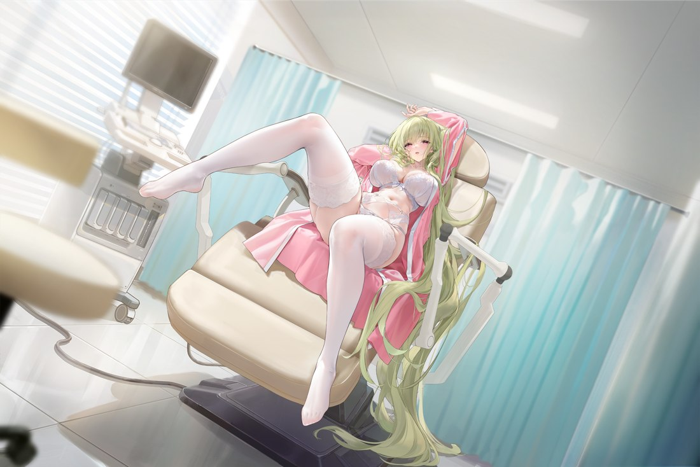

# Azur Lane Painting Restore

**v1.2** · Python 3.10+ · Windows / Linux / macOS · MIT

[阅读中文简介](#碧蓝航线立绘还原工具)

Reconstruct static character illustrations from local *Azur Lane* AssetBundles. The tool assembles texture fragments using the game’s meshes and layer layout, preserves canvas size and transparency, and exports the artwork and its facial expressions as PNG files.



*nabulesi_3 · Preview of the 3814 × 2544 restored PNG.*

### Quick start

1. On Windows, run `启动工具.bat`. On Linux or macOS, run `pip install -r requirements.txt`, then `./run.sh --gui`. The graphical interface requires Tkinter.
2. Select the `AssetBundles` folder containing `painting/` and choose an output folder. Some illustrations also need `paintingface/` for their default face or additional expressions.
3. Click **扫描 / 刷新** (Scan), select the illustrations you want, then click **开始还原** (Restore).

Each illustration has its own output folder. The main file is `<name>.png`. Additional expressions start at `<name>_exp_1.png`. Re-exporting refreshes the numbered files and removes the legacy `_exp.png` copy. Using `--no-face` clears previously exported expressions for that illustration.

### Command line

```bash
python al_restore.py --bundles "/path/to/AssetBundles" --out "./restored" --only "nabulesi_3,banerwei_4"
```

Omit `--only` to restore all paintings. Use `--layer` to export individual layers, `--jobs N` to process the first N paintings, and `--help` for all options.

### Troubleshooting and use

If a layer is missing, run `python check_materials.py --bundles "/path/to/AssetBundles"` to check for missing texture packs. Canvas dimensions come from the game, and artwork can vary between asset versions.

This free tool reads local assets for personal study. Please refrain from mod creation, redistribution of game assets, or commercial use. The MIT license covers the tool’s code. Game artwork © Manjuu / Yongshi.

## 碧蓝航线立绘还原工具

从《碧蓝航线》本地 AssetBundles 资源中还原静态角色立绘。工具按照游戏中的网格和图层布局拼合贴图碎片，保留原始画布尺寸与透明区域，将主图和表情差分导出为 PNG。

### 快速开始

1. Windows 双击 `启动工具.bat`。Linux 或 macOS 先运行 `pip install -r requirements.txt`，再运行 `./run.sh --gui`。图形界面需要 Tkinter。
2. 选择含 `painting/` 的 AssetBundles 根目录，并指定输出目录。部分立绘还需要 `paintingface/` 来补全默认面部或生成表情差分。
3. 点击 **扫描 / 刷新**，选中立绘，再点击 **开始还原**。

每套立绘保存到同名文件夹。例如，`nabulesi_3.png` 是主图，`nabulesi_3_exp_1.png` 至 `nabulesi_3_exp_13.png` 是这套立绘的 13 张表情差分。重新导出时会清理旧版 `_exp.png` 副本和多余编号。使用 `--no-face` 重新导出时，会清空该立绘之前导出的表情。

### 命令行

```powershell
python al_restore.py --bundles "D:\Game\AzurLane\AssetBundles" --out "D:\还原输出" --only "nabulesi_3,banerwei_4"
```

省略 `--only` 即可还原全部立绘。`--layer` 同时导出各图层，`--jobs N` 只处理前 N 套立绘，`--help` 列出完整参数。

### 素材检查与使用说明

若成品缺少背景或某个图层，可运行 `check_materials.py` 检查缺少的贴图包。画布尺寸由游戏资源决定，不同版本的素材可能得到不同画面。

本工具免费，仅供个人学习研究。请勿用于 MOD 制作、游戏素材二次分发或商业用途。工具代码采用 MIT 许可证，游戏素材版权归蛮啾网络、勇仕网络所有。

### Credits / 致谢

DeepSeek-V4.1-Flash assisted with layer positioning, batch verification, and documentation. The layer reconstruction approach draws on ALPA. Layout rules were independently checked against official promotional artwork. [ALPA](https://github.com/Deficuet/AzurLanePaintingAnalysis-Kt)

DeepSeek-V4.1-Flash 协助完成图层定位分析、全库批量验证和文档整理。图层拼图思路参考 ALPA，布局规则通过与官方宣传图逐像素比对独立验证。

Maintainer / 维护者：[kisaki-love](https://github.com/kisaki-love) · [MIT License](LICENSE)
