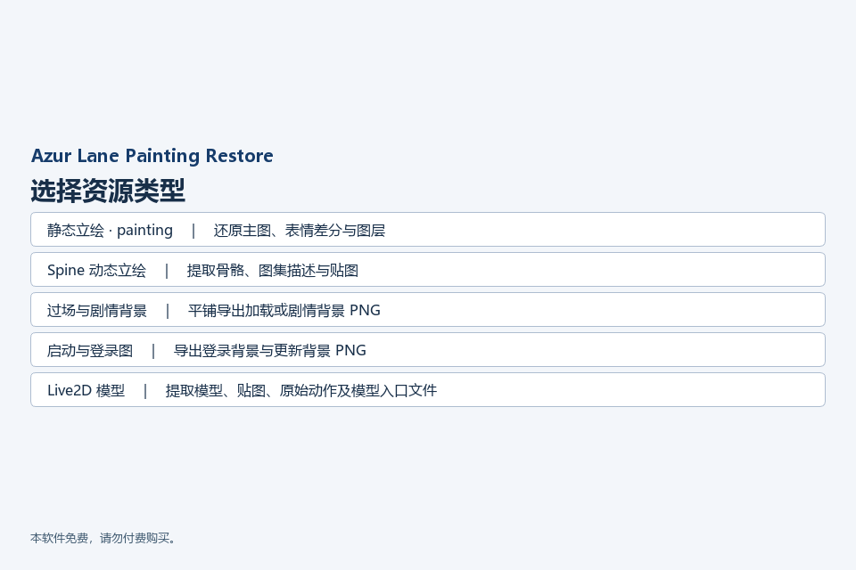

# Azur Lane Painting Restore

Restore static illustrations and export Spine or Live2D assets from your local *Azur Lane* game files. Version 2.0 Preview includes a Windows x64 desktop app and a command-line exporter. The interface is in Simplified Chinese.

**[Download the free Windows x64 portable ZIP](https://github.com/kisaki-love/BLHX-painting-restore/releases/download/v2.0-preview/PaintingRestore-v2.0-preview-windows-x64.zip)** · [Release notes](https://github.com/kisaki-love/BLHX-painting-restore/releases/tag/v2.0-preview) · [中文说明](#碧蓝航线立绘还原工具)



| Entry | Output |
|---|---|
| Painting | Full-size transparent artwork, numbered expression variants and optional layers. Identical source faces are skipped before composition. |
| Spine | Skeleton, atlas and texture files extracted for the selected model. |
| Live2D | Compiled model, texture atlases, original Unity animation clips and converted Cubism motions. Physics, poses and expressions are included when available. |

### Get started

1. Extract the entire ZIP and run `PaintingRestore.exe`. Keep the adjacent `_internal` directory. The portable build includes Python and its dependencies.
2. Choose a resource type and select the game package folder, `files`, or `AssetBundles`. For example, select `com.bilibili.azurlane/files/AssetBundles` so that sibling resource folders can be found.
3. Search for a skin, select it, choose an output directory and start the task. Expand a result to see missing assets or conversion issues.

For Live2D, open the generated `<skin>.model3.json` in Cubism Viewer. The exporter keeps the serialized clips in `AnimationClip/` and writes supported parameter and part-opacity curves to `motions/*.motion3.json`. See `manifest.json` for skipped bindings and conversion errors. The game’s touch rules, voice menus and EX Studio interactions require separate configuration.

### Command line

```powershell
.\PaintingRestore-CLI.exe --asset-type live2d --bundles "D:\Game\files\AssetBundles" --out "D:\Exports" --only nabulesi_3
```

Use `--asset-type painting` or `--asset-type spine` for the other modes. Run `--help` for all options. For a source checkout with Python 3.12, run `python -m pip install -r requirements.txt`, then `python al_restore.py --gui`.

## 碧蓝航线立绘还原工具

从本地《碧蓝航线》资源还原静态立绘，或提取 Spine、Live2D 动态素材。**软件免费，请勿付费购买。** [下载 Windows x64 便携包](https://github.com/kisaki-love/BLHX-painting-restore/releases/download/v2.0-preview/PaintingRestore-v2.0-preview-windows-x64.zip) · [GitHub 更新地址](https://github.com/kisaki-love/BLHX-painting-restore/releases)

1. 完整解压 ZIP，双击 `PaintingRestore.exe`。保留同目录的 `_internal` 文件夹，无需另装 Python。
2. 选择「静态立绘」「Spine 动态立绘」或「Live2D 模型」，拖入游戏包根目录、`files` 或 `AssetBundles`。目录示例为 `com.bilibili.azurlane/files/AssetBundles`。
3. 搜索并勾选资源，设置输出目录后开始。勾选状态会跨搜索保留；启用「隐藏 _hx 和谐版」会从本次处理范围排除这些变体。任务结束后可展开查看问题或重试失败项。

| 入口 | 能导出什么 |
|---|---|
| 静态立绘 | 主图、从 `_exp_1.png` 开始编号的表情差分，可选分层 PNG。每套底图只合成一次，贴脸前跳过重复源表情。 |
| Spine | 骨骼、图集描述及贴图。按模型引用从共享资源包提取所选变体的素材。 |
| Live2D | `.moc3`、贴图、原始 `.animclip.bin` 和转换后的 `.motion3.json`。模型和贴图索引完整时生成 `.model3.json` 入口，物理、姿势、表情及遮罩按资源提供。 |

要预览 Live2D，请在 Cubism Viewer 中打开导出目录里的 `<皮肤名>.model3.json`。动作转换情况记录在 `manifest.json`。游戏点击、拖动、语音菜单及 EX Studio 互动需另外配置。命令行参数见上方示例或 `PaintingRestore-CLI.exe --help`。

### License / 使用许可

New v2.0 code and documentation are licensed for non-commercial study and research. Code inherited from v1.2 retains its MIT license. Game artwork belongs to its respective rights holders. The portable download includes third-party notices.

v2.0 新增自有代码和文档仅供非商业学习研究。继承自 v1.2 的代码沿用 MIT 许可；游戏素材权利归各权利人。便携包内附第三方许可。[v2.0 许可](LICENSE) · [v1.2 MIT 许可](LICENSE-v1.2-MIT.txt) · [更新记录](CHANGELOG.md)

### Credits / 致谢

Developed with AI assistance. The approach to composing artwork layers draws on ALPA. 本工具由 AI 辅助开发，立绘图层的拼合思路参考了 [ALPA](https://github.com/Deficuet/AzurLanePaintingAnalysis-Kt)。
