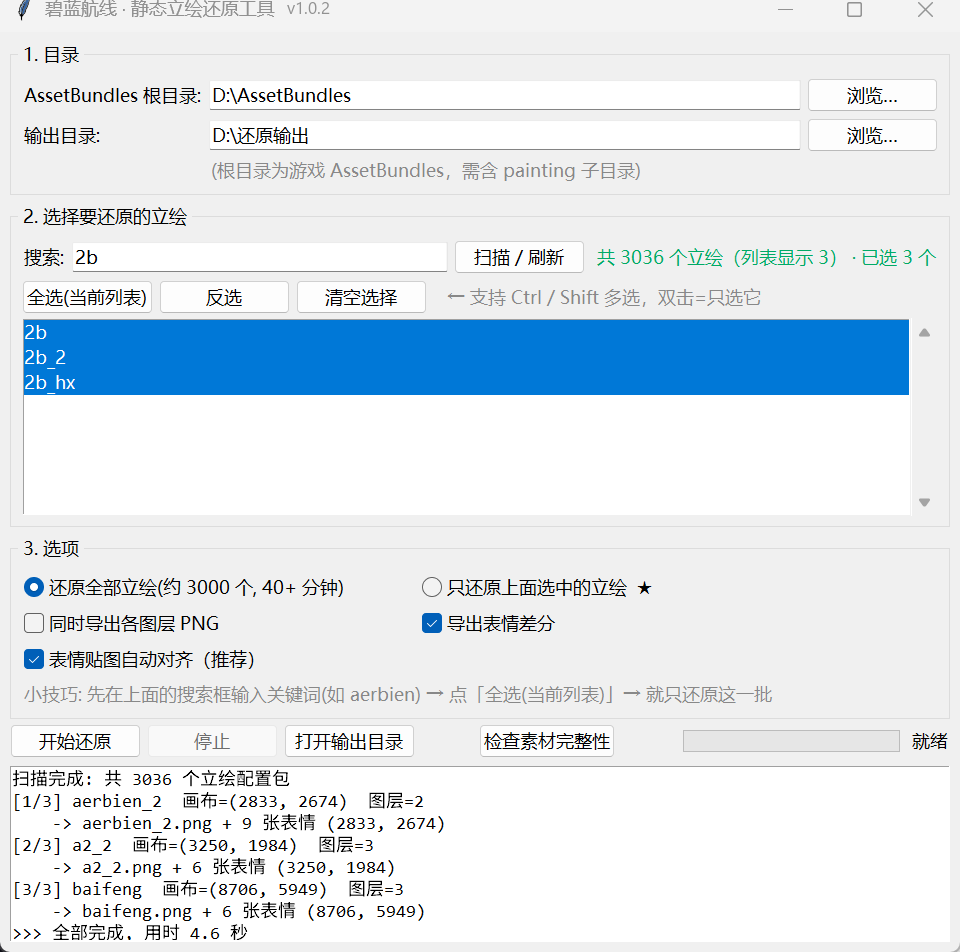
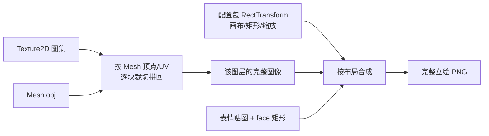

# 碧蓝航线 · 静态立绘还原工具


> [!WARNING]
> **本工具仅供个人学习、研究使用。**
> 游戏素材版权归 蛮啾网络 / 勇仕网络 所有；使用游戏素材制作 MOD 等修改行为**同样为官方所禁止**。
> 请勿将本工具或其产物用于 MOD 制作、二次分发、公开传播或任何商业用途。

把《碧蓝航线》资源包里被切碎、散落在图集里的立绘，还原成**一张完整的 PNG**（含表情差分）。



```
原始资源                     还原结果
painting/<立绘名>       →    <立绘名>.png            完整立绘（透明底）
painting/<图层>_tex     →    <立绘名>_exp_1..N.png   表情差分
paintingface/<立绘名>
```

## 特点

- **真·完整还原**：不是把碎片拼起来就完事 —— 会读游戏自己的布局数据（画布尺寸、每个图层的位置/缩放、
  表情框在哪），所以人物、背景、前景的相对位置都是对的
- **自动出表情差分**：`paintingface` 里的表情贴图会自动贴到脸上
- **批量**：全库 3000+ 立绘一键跑完（约 45 分钟），也可以只挑几个
- **图形界面 + 命令行**：界面里能搜索、多选立绘，实时看日志
- **素材体检**：附带 `check_materials.py`，告诉你哪几个立绘缺贴图包
- 输出 RGBA 透明底，便于查看与分析素材
- 纯 Python，跨平台；Windows 双击 `.bat` 即可

## 原理（为什么直接解包的图是碎的）

游戏里的立绘**不是一张图**，而是：

| 资源 | 内容 |
|---|---|
| `painting\<立绘名>` | **配置包**：只有 GameObject / RectTransform / Image，存的是"布局"（画布多大、每层放哪、缩放多少、表情框在哪），**不含贴图** |
| `painting\<图层名>_tex` | **贴图包**：`Texture2D`（一张图集）+ `Mesh`（告诉你怎么把图集里的碎片摆回去） |
| `paintingface\<立绘名>` | 表情贴图 |

所以流程是三步：



两个容易踩的坑（本工具已处理）：

1. **图层定位不能只看矩形高度**。Mesh 顶点是「图层原稿的像素坐标」，原点 `(0,0)` 就是该 Image
   矩形的左下角；少数图层原稿比矩形大，此时必须按顶点最高处定位，否则整段偏移（最坏几千像素）。
2. **有的图层没有 Mesh**（图集里只有一张整图），这类图层走另一条分支，缩放不能再算一次。

## 安装

需要 **Python 3.10+**。

- **Windows**：直接双击 `启动工具.bat`，缺依赖会自动 `pip install`。
- **Linux / macOS**：
  ```bash
  pip install -r requirements.txt      # GUI 还需要系统装 tkinter（如 apt install python3-tk）
  ./run.sh --gui
  ```

依赖：`pillow`、`numpy`、`UnityPy`、`opencv-python-headless`（最后一个只用于表情自动对齐，缺了也能跑）。

## 使用

### 图形界面（推荐）

双击 **`启动工具.bat`**：

1. 选 **AssetBundles 根目录**（含 `painting\` 的那一层）和输出目录
2. 点「扫描 / 刷新」→ 列表里勾选要还原的立绘（可搜索：输 `aerbien` 只显示相关）
3. 选「还原全部立绘」或「只还原上面选中的立绘」→ 点「开始还原」

> 想只还原某一批：搜索框输关键词 → 点「全选(当前列表)」→ 选「只还原上面选中的立绘」。

### 命令行

```bash
# 全部还原（约 3000 个）
python al_restore.py --bundles "D:\Game\AzurLane\AssetBundles" --out "D:\还原输出"

# 只还原若干
python al_restore.py --bundles "...\AssetBundles" --out "D:\还原输出" --only "aerbien_2,sali_2"

# 连每层的分层 PNG 一起导出
python al_restore.py --bundles "...\AssetBundles" --out "D:\还原输出" --layer

# 不要表情差分
python al_restore.py --bundles "...\AssetBundles" --out "D:\还原输出" --no-face

# 只有解包好的 Texture2D / Mesh（没有配置包）→ 只能做分层还原
python al_restore.py --unpacked "...\Texture2D" "...\Mesh" "D:\分层输出"
```

| 参数 | 说明 |
|---|---|
| `--bundles` | AssetBundles 根目录（必须含 `painting\`） |
| `--out` | 输出目录（默认 `<bundles>\..\还原输出`） |
| `--only` | 只处理指定立绘，逗号分隔 |
| `--layer` | 同时导出各图层 PNG |
| `--no-face` | 不导出表情差分 |
| `--no-face-align` | 关闭表情贴图自动对齐 |
| `--jobs N` | 只处理前 N 个（调试用） |
| `--unpacked TEXDIR MESHDIR OUTDIR` | 分层模式 |
| `--gui` | 打开界面 |

### 素材体检

```bash
python check_materials.py --bundles "...\AssetBundles" --out 素材缺失清单.txt
# 或者双击 检查素材.bat（会问你素材在哪，之后自动记住）
```

它会列出：哪几个立绘缺哪一层的贴图包（成品会缺那一块）、哪些立绘没有表情差分。

## 需要哪些素材

**只依赖两个目录**，`AssetBundles` 下其它几十个目录都不用管：

```
AssetBundles\
├── painting\        必需   每个立绘的配置包 + 各图层 _tex 贴图包
└── paintingface\    可选   表情差分贴图（不要表情可以不给）
```

也可以**只拷自己想要的**：新建个目录，里面放 `painting\`（只放你要的 `<立绘名>` 与
对应的 `<图层名>_tex`）和 `paintingface\`，选它就行。实测一个立绘通常不到 10 MB。

> ⚠️ 配置包不能省。只有解包出来的 `Texture2D`/`Mesh` 时，可以还原出每一层的图，
> 但拿不到画布尺寸和各层位置，拼不出完整立绘。

## 输出

```
<输出目录>
└── aerbien_2\
    ├── aerbien_2.png            基础立绘（无表情）
    ├── aerbien_2_exp.png        兼容 ALPA 导入的文件名（= 第 1 个表情）
    ├── aerbien_2_exp_1.png      表情差分 1
    ├── ...
    └── aerbien_2__layer__*.png  各图层（加了 --layer 时）
```

## 常见问题

**Q：跑完发现某个立绘缺背景 / 少一块？**
先用 `check_materials.py` 查一下 —— 大概率是这份资源里缺对应的 `_tex` 包。
有些立绘（如 `bisimaiz`）某些层的贴图在游戏包里根本就没有，属于素材不全。

**Q：和别人的还原结果像素对不上？**
不同游戏版本的资源会变（素材重绘、表情张数不同）。用哪版素材，出来就是哪版。

**Q：为什么有的立绘输出尺寸特别大（8000+ px）？**
画布尺寸是游戏自己定的，工具按原样输出。要缩小自己 resize 即可。

**Q：`Texture2D` 里看着有 UI 按钮、商店标签？**
那些是 Prefab 里的 UI 节点，不属于画面，工具会自动跳过。

## 说明

- 本工具只做**资源读取与重组**：读取本地已有的游戏资源文件，拼回完整图片。
  它**不修改游戏**、不注入进程、不绕过任何校验、不参与任何游戏内改动。
- 游戏素材版权归 **蛮啾网络 / 勇仕网络** 所有，本工具及其产物**仅供个人学习、研究使用**。
- ⚠️ **使用游戏素材制作 MOD 等修改行为同样为官方所禁止**，请勿将本工具或其产物用于
  MOD 制作、二次分发、公开传播或任何商业用途。若版权方提出要求，请立即删除相关素材与产物。
- 请支持正版游戏。

## 致谢

- **DeepSeek-V4.1-Flash** —— 本项目的代码由该大模型协助编写（图层定位规则逆向、全库批量验证、
  文档整理等）。
- 图层拼图的思路参考了开源项目
  [AzurLanePaintingExtract](https://github.com/azurlane-doujin/AzurLanePaintingExtract) 与 ALPA；
  布局规则由本项目独立逆向验证（用官方宣传图逐像素比对）。

## 贡献者

- [Tsukiyashirokisaki (@SOLASOLAdesu)](https://github.com/SOLASOLAdesu)

欢迎提 Issue / PR。

## License

MIT
